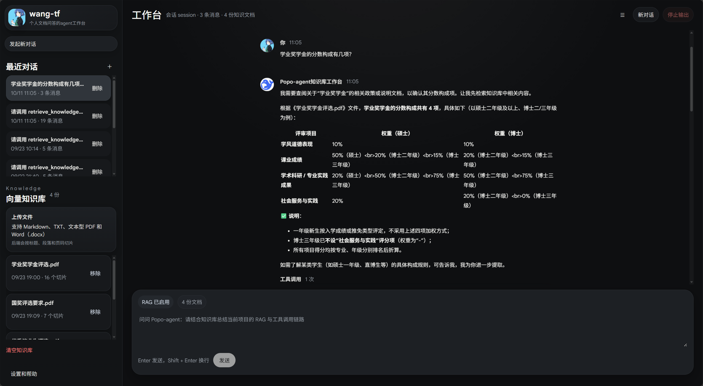
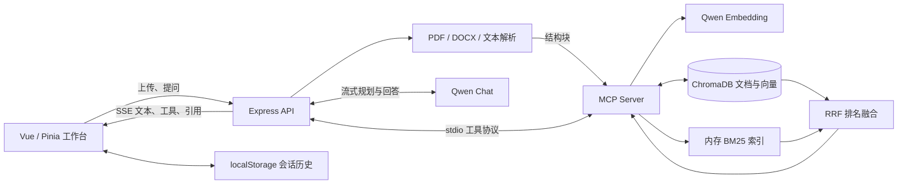
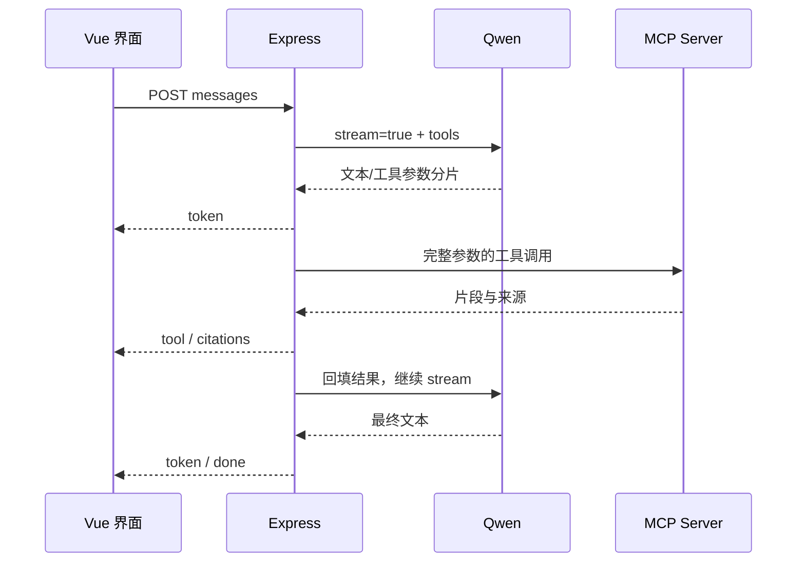

<h1 align="center">Popo-agent · 个人知识库工作台</h1>

<p align="center">上传资料 → 结构化分块 → 混合检索 → MCP 工具调用 → 流式回答与来源追踪</p>

<p align="center">Vue 3 · TypeScript · Pinia · Express · Qwen · MCP · ChromaDB</p>

Popo-agent 是一个面向个人文档问答的全栈 AI Agent 项目。用户上传 Markdown、TXT、文本型 PDF 或 Word 文档后，系统解析正文、保留章节与页码、生成向量并持久化到 ChromaDB。提问时，模型通过 MCP 工具检索知识库，结合向量与关键词两路结果生成流式回答，界面同时展示工具状态和引用片段。

项目覆盖了 AI 应用中的几个实际工程问题：不同格式文档如何组织、语义与精确词匹配如何结合、工具协议如何复用、流式工具参数如何拼接，以及长会话如何减少渲染和存储开销。



> 截图展示本地运行效果，仓库未提供在线托管服务。真实聊天与文档向量化需要自己的 Qwen API Key；知识库功能还需要启动本地 Chroma 服务。

## 🛠 技术栈

### 前端
- **Vue 3 + TypeScript + vite**
- **Pinia**：管理会话、消息、知识库列表和生成状态
- **vue-virtual-scroller**：动态高度虚拟列表，优化长会话渲染
- **markdown-it + DOMPurify**：Markdown 渲染与 HTML 清理
- **Fetch + ReadableStream + SSE**：接收流式文本、工具状态与引用
- **AbortController**：中断正在进行的对话请求

### 后端
- **Node.js + Express**：提供 HTTP API、SSE 流式接口与静态资源服务
- **Multer**：接收文档上传
- **pdf-parse**：提取 PDF 文本与页码
- **Mammoth**：解析 Word（.docx）文档
- **MCP SDK + Zod**：实现工具协议通信与工具输入校验

### 数据存储
- **ChromaDB**：持久化文档切片、向量与来源元数据
- **localStorage**：保存浏览器聊天历史与当前会话

### AI 与检索
- **Qwen Chat Completions**：多轮对话、工具决策与流式生成
- **Qwen Embedding**：将文档片段和用户问题转换为向量
- **结构化文档分块**：结合标题、段落、页码与估算 token 预算切片
- **BM25**：关键词召回，补充精确词匹配
- **RRF**：融合向量与关键词两路检索排名
- **MCP + Function Calling**：执行工具并将结果回填给模型

## 功能概览

| 模块 | 当前实现 |
| --- | --- |
| 文档导入 | Markdown、TXT、文本型 PDF、Word `.docx`；中文文件名修复 |
| 结构化分块 | 按章节、段落和页码组织，估算 token 预算，长段落拆分与重叠 |
| 持久化 | ChromaDB 保存片段、向量和来源元数据，重启后恢复 |
| 混合检索 | Qwen Embedding 向量召回 + BM25 关键词召回 + RRF 排名融合 |
| Agent 编排 | MCP stdio 工具协议，模型选择工具，结果回填后继续生成 |
| 流式交互 | SSE 文本、工具状态、引用、完成与错误事件，支持中断 |
| 会话管理 | 新建、切换、删除会话，localStorage 保存聊天历史 |
| 内容展示 | Markdown 渲染、DOMPurify 清理、工具参数和来源片段展示 |
| 前端性能 | 动态高度虚拟列表、聊天面板异步加载、200 ms 合并持久化写入 |
| 验证能力 | 21 个单元测试、32 题检索评测集、列表与持久化性能对比页 |

## 相比最初版本的变化

| 方面 | 初始版本 | 当前版本 |
| --- | --- | --- |
| 文档格式 | UTF-8 文本、Markdown | Markdown、TXT、PDF、DOCX |
| 分块 | 900 字符一块，重叠 160 字符 | 结构块 + 约 500 个估算 token 的目标预算 |
| 存储 | MCP 进程内存 | ChromaDB 持久化与余弦距离索引 |
| 检索 | 单路向量相似度排序 | 向量 + BM25 + RRF |
| 来源 | 文档名与片段 | 增加章节、页码、两路排名与融合分数 |
| 请求取消 | 主要停止客户端接收 | AbortSignal 传递到模型 HTTP 请求与 MCP 调用 |

## 技术栈

版本范围来自 `package.json`，实际安装版本以 `package-lock.json` 为准。

| 层次 | 技术 | 用途 |
| --- | --- | --- |
| 前端 | Vue `^3.5.13`、TypeScript `^5.7.3`、Vite `^6.0.7` | 组件、类型检查与构建 |
| 状态 | Pinia `^3.0.3` | 会话、消息、知识文档与生成状态 |
| 列表 | vue-virtual-scroller `^2.0.0-beta.8` | 动态高度虚拟列表 |
| 渲染 | markdown-it `^14.1.0`、DOMPurify `^3.2.6` | Markdown 转 HTML 与清理输出 |
| 服务端 | Node.js、Express `^4.21.2`、cors、dotenv | API、SSE、静态资源与配置 |
| 文档 | Multer `^2.0.2`、pdf-parse `^2.4.5`、Mammoth `^1.12.3` | 内存上传、PDF 与 DOCX 解析 |
| 工具 | MCP SDK `^1.29.0`、Zod `^4.3.6` | stdio 客户端/服务端、工具输入 Schema |
| 模型 | Qwen 兼容 Chat Completions / Embeddings API | 对话、工具决策与向量化 |
| 向量库 | Chroma JS Client `^3.5.0`、Python Chroma 服务 `>=1.1.13,<2.0` | 文档与向量持久化、HNSW 余弦检索 |
| 检索算法 | 自实现 BM25、RRF、Intl.Segmenter | 分词、技术标识符保留、排名融合 |
| 数据与测试 | localStorage、Node.js Test Runner | 浏览器会话保存、单元测试 |

Python 用于启动 Chroma 服务，Agent 编排与文档解析仍由 Node.js 执行。当前没有使用 MySQL，也没有依赖 LangChain / LlamaIndex。

## 系统架构



Express 启动 MCP 子进程并缓存连接。MCP 首次访问知识库时，从 Chroma 恢复切片和文档列表、重建内存 BM25 索引，无需重新生成已有文档的 embedding。

## 快速开始

### 1. 环境与依赖

- Node.js 22 或更高版本，建议 Node.js 24；本次发布检查使用 v24.14.0。
- npm；仓库提供锁文件，使用 `npm ci` 安装。
- Python 3.10 或更高版本，用于本地 Chroma 服务。
- 有效 Qwen API Key 与可访问所配置接口的网络。

```bash
git clone https://github.com/11fengt/Popo-agent.git
cd Popo-agent
npm ci
```

Windows PowerShell 如果禁止执行 `npm.ps1`，把命令中的 `npm` 写为 `npm.cmd` 即可。

### 2. 配置模型与 Chroma

```powershell
# Windows PowerShell
Copy-Item .env.example .env.local
```

macOS / Linux 使用 `cp .env.example .env.local`。编辑本机 `.env.local`：

| 配置项 | 默认值 / 示例 | 说明 |
| --- | --- | --- |
| `QWEN_API_KEY` | `your_api_key` | 替换为自己的 Key，不放入前端代码或 Git |
| `QWEN_BASE_URL` | `https://dashscope.aliyuncs.com/compatible-mode/v1` | 与 Key 所属服务区域匹配 |
| `QWEN_MODEL` | `qwen-plus` | 支持工具调用的聊天模型 |
| `QWEN_EMBEDDING_MODEL` | `text-embedding-v3` | 文档与问题向量化模型 |
| `SERVER_PORT` | `8787` | Express 端口 |
| `CHROMA_HOST` | `127.0.0.1` | Chroma 主机 |
| `CHROMA_PORT` | `8000` | Chroma 端口 |
| `CHROMA_SSL` | `false` | 是否使用 TLS |
| `CHROMA_COLLECTION` | `yuan_agent_knowledge` | 集合名；保留既有名称以复用原数据 |

### 3. 安装并启动 Chroma

Windows PowerShell，在项目根目录执行：

```powershell
python -m venv .venv
.\.venv\Scripts\python.exe -m pip install -r requirements-chroma.txt
.\.venv\Scripts\chroma.exe run --path .\data\chroma --host 127.0.0.1 --port 8000
```

macOS / Linux：

```bash
python3 -m venv .venv
.venv/bin/python -m pip install -r requirements-chroma.txt
.venv/bin/chroma run --path ./data/chroma --host 127.0.0.1 --port 8000
```

保持该终端运行。显式指定 `127.0.0.1` 可避免部分环境只监听 IPv6、后端却连接 IPv4 的问题。`data/chroma` 已加入 Git 忽略规则；停止服务不会删除该目录的数据。

### 4. 启动前后端

另开终端，在项目根目录执行：

```bash
npm run dev
```

| 服务 | 默认地址 |
| --- | --- |
| Vue 界面 | `http://localhost:5173` |
| Express | `http://127.0.0.1:8787` |
| Chroma | `http://127.0.0.1:8000` |

Vite 将 `/api` 代理到 `8787`。修改 `SERVER_PORT` 时需同步修改 `vite.config.ts`；前端 `5173` 被占用时会直接报错。

### 5. 推荐体验路径

1. 上传 [examples/popo-guide.md](examples/popo-guide.md)。
2. 提问：“根据文档，知识库重启后还在吗？与聊天记录的保存方式有什么区别？”
3. 查看流式文本、工具状态和参考来源中的命中片段。
4. 保留 Chroma 数据目录，停止并重启后端，检查知识文档恢复。
5. 切换会话并刷新页面，查看浏览器历史恢复。

无 Key 时仍可查看界面、管理本地会话和运行测试/性能页；真实聊天、文档向量化及语义检索需要有效 Key。

## 文档处理与混合检索

### 文件解析与分块

| 格式 | 解析方式 | 来源信息 |
| --- | --- | --- |
| `.md` / `.markdown` | 标题层级、段落、代码围栏及部分列表/表格结构 | 章节路径、块类型 |
| `.txt` | UTF-8 解码，按空行组织段落 | 段落结构 |
| `.pdf` | pdf-parse 按页提取文本，页内按段落组织 | 起止页码 |
| `.docx` | Mammoth 转 Markdown 后解析 | 章节和段落；没有 Word 页码 |


[document-processing.js](server/document-processing.js)使用目标约 500、正文上限预算 650、最小聚合阈值 280 个估算 token。章节变化时结束当前切片；超长段落先按句子拆分，必要时按字符预算切分，相邻拆分段保留约 80 个估算 token 的尾部重叠。

token 数由字符与词长规则估算，不是 Qwen 精确 tokenizer；章节前缀会增加最终输入长度。

### 两路召回与融合

- **向量路**：Qwen 生成查询向量，Chroma 在余弦空间检索，以 `1 - distance` 计分，过滤分数不大于 `0.15` 的结果。
- **关键词路**：`Intl.Segmenter` 分词、归一化和停用词过滤，并额外保留技术标识符；BM25 使用 `k1 = 1.2`、`b = 0.75`。
- **候选数量**：`min(总切片数, max(topK × 5, 20))`，默认 `topK = 4`，工具允许 1～10。
- **RRF**：默认两路权重均为 1、常数 60，按排名融合，避免直接相加不同量纲的分数。

```text
RRF(chunk) = 1 / (60 + vectorRank) + 1 / (60 + keywordRank)
```

未进入某路候选的切片不获得该路贡献。当前没有额外重排模型。引用对象保留章节、页码、向量/BM25 排名与分数；界面的“相关度”目前显示 RRF 分数，不是百分比或回答可信概率。

### 数据存储分工

| 数据 | 位置 | 生命周期 |
| --- | --- | --- |
| 文档切片、embedding、来源元数据 | ChromaDB | 持久化到指定目录 |
| 文档列表、切片缓存、BM25 索引 | MCP 内存 | 按需恢复，导入/删除后更新 |
| 聊天会话与当前会话 ID | localStorage | 当前浏览器与源内保存，不跨设备同步 |

当前逐切片请求 embedding，Chroma 使用批次写入。BM25 仍是内存索引，规模增大后需进一步评估恢复时间和内存占用。

## Agent 与流式执行

Express 通过 MCP Client 连接独立 stdio MCP Server，将工具 Schema 映射为 Function Calling 定义。模型输出工具调用时，服务端按索引拼接 ID、名称和参数，确认完整 JSON 后执行，再把工具结果加入上下文。



最多 4 轮工具规划，达到预算后发起一次不带工具的流式请求收束回答。普通问题可在单次流式请求中回答，避免先生成非流式完整回答再重复请求。

上游解析器处理 UTF-8 跨包、CRLF、usage-only 事件、交错工具参数、异常 JSON 与截断输出。用户中断或连接关闭时，AbortSignal 传递到模型请求和 MCP 客户端并阻止后续事件；已经完成的远端计算和工具副作用不会回滚。

## HTTP API 与 MCP 工具

开发 Base URL 为 `http://127.0.0.1:8787`，当前没有账号认证。

| 方法 | 路径 | 用途 |
| --- | --- | --- |
| GET | `/api/health` | 检查 MCP 与知识库访问，返回文档数量；不验证模型 Key |
| GET | `/api/knowledge` | 文档列表、类型和切片数 |
| POST | `/api/knowledge/upload` | multipart 多文件上传，字段名 `files` |
| DELETE | `/api/knowledge/:id` | 删除指定文档和切片 |
| DELETE | `/api/knowledge` | 清空当前集合的知识数据 |
| POST | `/api/chat/stream` | 接收 `messages`，返回 SSE |

聊天请求示例：

```json
{ "messages": [{ "role": "user", "content": "请结合知识库说明项目的检索流程" }] }
```

| SSE 事件 | 数据 | 说明 |
| --- | --- | --- |
| `token` | `{ token }` | 追加文本 |
| `tool` | `{ id, name, args, status, result? }` | running / success / error |
| `citations` | `{ citations }` | 本次工具来源片段 |
| `done` | `{ citations, tools }` | 完成汇总 |
| `error` | `{ code, message, details }` | 流式运行错误 |

流式响应头发出后，运行错误通过 `error` 事件表达，不能只按 HTTP 200 判断成功。普通业务错误使用 `{ error, code, details }`。

| MCP 工具 | 参数 | 功能 |
| --- | --- | --- |
| `retrieve_knowledge` | `query`，可选 `topK` | 混合检索 |
| `list_knowledge_documents` | 无 | 文档列表 |
| `ingest_knowledge_documents` | `documents` | 接收解析后文档/结构块并向量化 |
| `delete_knowledge_document` | `id` | 删除文档 |
| `clear_knowledge_documents` | 无 | 清空知识库 |
| `get_current_time` | 无 | 当前时间 |

六个工具都会映射给模型。完整请求、响应和错误示例见 [docs/API.md](docs/API.md)。

## 检索评测

仓库包含 [32 题评测集](eval/rag-recall-cases.json)、[脚本](scripts/evaluate-recall.js)和[已有报告](eval/recall-report.json)。问题来自四份制度文档，每份八题。

已有报告生成于 **2026-09-23**：32 个切片、候选上限 20、向量阈值 0.15、embedding 模型 `text-embedding-v3`。

| 方法 | Top 3 命中题数 | 命中率 |
| --- | --- | --- |
| 纯向量检索 | 25 / 32 | 78.13% |
| 向量 + BM25 + RRF | 30 / 32 | 93.75% |

这组题多命中 5 题，提升约 15.6 个百分点。结果来自提供的历史报告，本次发布未重新调用模型评测，不代表所有知识库上的通用提升。

复测需自行准备并有权使用数据集列出的四份原文；仓库不打包本机数据库或原始制度文件。上传文档并启动 Chroma 后执行：

```bash
npm run eval:recall

# 指定新输出文件可保留已有报告
npm run eval:recall -- --dataset=eval/rag-recall-cases.json --output=eval/recall-report-local.json --k=3
```

每题只生成一次查询向量，供两种方法使用。详见 [eval/README.md](eval/README.md)。

## 前端性能实践

**动态高度虚拟列表**：使用 `DynamicScroller` / `DynamicScrollerItem`，将 Markdown、引用与工具结果变化作为高度更新依赖，减少长列表 DOM 数量。

**异步加载**：通过 `defineAsyncComponent` 延迟加载聊天面板，配合加载与失败提示。

**合并持久化**：每个 token 立即更新内存，localStorage 序列化与写入合并到 200 ms 时间窗口。在会话切换、新建、删除以及回答完成、停止、异常等节点立即保存或补交待保存数据。

开发服务启动后访问以下模拟测试页，不调用真实模型，结果受设备和浏览器状态影响：

```text
http://localhost:5173/benchmark.html?mode=plain&count=1000
http://localhost:5173/benchmark.html?mode=virtual&count=1000
http://localhost:5173/benchmark.html?test=persistence&mode=baseline
http://localhost:5173/benchmark.html?test=persistence&mode=optimized
```

## 测试、构建与本地部署

```bash
npm test
npm run test:stream
npm run test:retrieval
npm run test:documents

# 类型检查 + 应用构建
npm run build

# 性能页单独输出 dist-benchmark
npm run build:benchmark

# 提供 dist 静态文件和 API；Chroma 需另行保持运行
npm start
```

构建后打开 `http://127.0.0.1:8787`。`npm run preview` 只预览前端产物，不启动 Agent 后端，也不继承开发 `/api` 代理。

单元测试不读取真实 Key、不连接 Chroma、不调用 Qwen，覆盖流式事件、工具参数、取消行为、文档分块、PDF 提取、文件名、BM25 和 RRF。此次发布检查范围见 [docs/VALIDATION.md](docs/VALIDATION.md)。

## 项目结构

```text
Popo-agent/
├─ src/
│  ├─ components/               # 消息、会话、知识库与输入组件
│  ├─ composables/              # 保留的浏览器语音识别实现
│  ├─ services/                 # HTTP / SSE 与 Markdown 渲染
│  ├─ stores/chat.ts            # 会话状态与合并持久化
│  ├─ types/                    # 消息、引用、工具、文档类型
│  └─ benchmark/                # 列表与存储对比页
├─ server/
│  ├─ index.js                  # Express、MCP Client 与 SSE
│  ├─ chat-stream.js            # 上游流解析与工具执行循环
│  ├─ mcp-server.js             # MCP 工具注册与知识流程
│  ├─ document-processing.js    # 文件解析与分块
│  ├─ knowledge-store.js        # Chroma 存储适配
│  ├─ retrieval.js              # 分词、BM25、RRF
│  ├─ filename.js               # 文件名归一化
│  └─ *.test.js                 # 单元测试
├─ scripts/evaluate-recall.js   # 检索对照评测
├─ eval/                       # 问题、说明与历史报告
├─ examples/                   # 可上传的示例知识
├─ docs/                       # 接口、验证记录和截图
├─ public/                     # 界面静态资源
├─ requirements-chroma.txt      # Python Chroma 依赖
└─ .env.example                # 配置模板
```


后续方向：按用户授权、上传与资源限制、重排、无答案评测、可验证的引用定位，以及实际模型链路测试。

## 源码阅读建议

1. [文档处理](server/document-processing.js)：文件如何变成带来源的结构块和切片。
2. [存储适配](server/knowledge-store.js)与[检索算法](server/retrieval.js)：持久化、向量召回、BM25 和 RRF。
3. [MCP Server](server/mcp-server.js)：如何将能力注册成工具。
4. [流式执行](server/chat-stream.js)与[Express](server/index.js)：如何拼接参数、执行工具并持续输出。
5. [会话 Store](src/stores/chat.ts)与[聊天列表](src/components/ChatPanel.vue)：如何保持会话与优化长列表。
