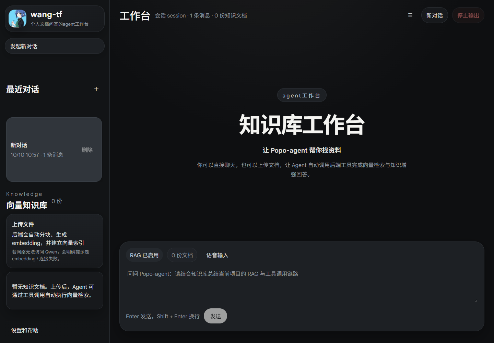
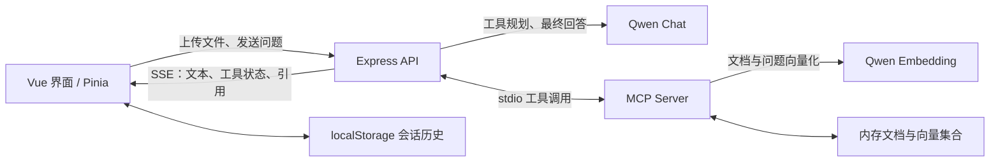
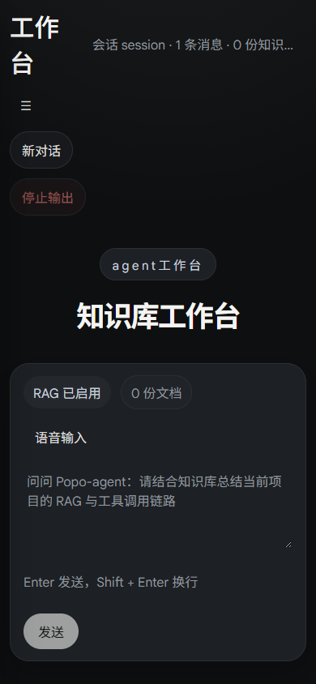

<h1 align="center">Popo-agent</h1>

<p align="center">一个面向个人文档问答的 AI Agent 工作台</p>
<p align="center">Vue 3 · TypeScript · Pinia · Node.js · Qwen · MCP · RAG</p>

Popo-agent 将对话界面、文档知识库和 Agent 工具调用结合在一起：上传文本文件后，后端完成分块和向量化，Agent 根据问题调用 MCP 工具检索内容，再通过流式输出生成回答。界面同时展示工具执行状态和检索来源，便于理解回答过程。



## 核心功能

- **流式对话**：通过 SSE 接收文本分片、工具状态、引用、完成和错误事件；支持在界面停止接收输出。
- **文档知识库**：支持 UTF-8 编码的 `.txt`、`.md`、`.markdown`、`.json` 文件，以及文档列表、删除和清空操作。
- **RAG 检索**：文本按 900 个字符分块，相邻块重叠 160 个字符；调用 Qwen Embedding，以余弦相似度排序检索结果，默认返回前 4 条。
- **MCP 工具调用**：通过 stdio 连接独立 MCP 服务，由模型选择工具，后端执行并回传结果；工具规划阶段最多执行 4 轮。
- **会话管理**：创建、切换和删除会话，通过浏览器 localStorage 保存聊天历史。
- **长对话展示**：使用动态高度虚拟列表，按需渲染消息；聊天面板以异步组件加载。
- **Markdown 展示**：使用 markdown-it 渲染，关闭原始 HTML，并通过 DOMPurify 清理输出。
- **语音输入与响应式布局**：使用浏览器 SpeechRecognition；语音识别是否可用取决于浏览器、权限及其语音服务。

## 技术栈

| 层次 | 技术与用途 |
| --- | --- |
| 前端 | Vue 3、TypeScript、Vite、Pinia |
| 界面与渲染 | CSS、vue-virtual-scroller、markdown-it、DOMPurify |
| 后端 | Node.js、Express、Multer、dotenv |
| Agent 与工具 | Qwen Chat Completions、MCP SDK、Zod |
| 文档检索 | Qwen Embedding、内存向量集合、余弦相似度 |
| 数据保存 | 浏览器 localStorage 保存会话；MCP 进程内存保存知识库 |

当前版本没有使用 MySQL、Python 或独立向量数据库。

## 系统架构



一次文档问答的主要流程：

1. 上传文件，MCP 服务将文本分块，并为每个片段生成 embedding。
2. 提问后，Express 将历史消息和 MCP 工具定义提交给模型。
3. 模型选择检索工具，MCP 为问题生成向量，计算相似度并返回来源片段。
4. 工具结果回传模型，后端将最终回答流式发送给前端，并展示检索引用。

## 快速开始

建议使用 Node.js 22 或更高版本和 npm；本次发布副本在 Node.js 24 下通过构建和本地接口检查。

```bash
git clone https://github.com/11fengt/Popo-agent.git
cd Popo-agent
npm ci
```

复制环境配置，填写你自己的 Qwen API Key：

```powershell
# Windows PowerShell
Copy-Item .env.example .env.local
```

```bash
# macOS / Linux
cp .env.example .env.local
```

`.env.local` 配置项：

| 变量 | 默认值 / 示例 | 说明 |
| --- | --- | --- |
| `QWEN_API_KEY` | `your_api_key` | 必填，使用有权调用所选模型的 Key |
| `QWEN_BASE_URL` | `https://dashscope.aliyuncs.com/compatible-mode/v1` | 与 Key 所属服务区域匹配的兼容接口地址 |
| `QWEN_MODEL` | `qwen-plus` | 支持工具调用的聊天模型 |
| `QWEN_EMBEDDING_MODEL` | `text-embedding-v3` | 文档与问题向量化模型 |
| `SERVER_PORT` | `8787` | Express 服务端口 |

```bash
npm run dev
```

前端默认位于 `http://localhost:5173`，后端位于 `http://127.0.0.1:8787`。端口被占用时以终端输出为准；Vite 默认将 `/api` 代理到 `8787`，修改后端端口时需同步调整 `vite.config.ts`。

没有 API Key 时仍可以查看界面、管理本地会话和运行性能测试；真实聊天、文档向量化和向量检索需要有效 Key 与网络连接。

### 本地构建与运行

```bash
npm run build
npm start
```

打开 `http://127.0.0.1:8787`。Express 同时提供 `dist` 静态文件和 API。

`npm run preview` 仅用于检查前端构建产物，不会启动 Agent 后端，也没有开发模式的 `/api` 代理。完整演示请使用上述 `npm start`。

## 演示建议

1. 新建会话，发送普通问题，观察流式文本。
2. 上传仓库中的 [示例文档](examples/popo-guide.md)。
3. 提问：“根据上传的文档，Popo-agent 的知识库重启后还在吗？请说明依据。”
4. 展开工具调用和引用，展示检索流程。
5. 切换会话并刷新页面，展示本地历史恢复。
6. 打开下方性能对比页面，解释优化动机、实验设置和取舍。

截图展示本地界面，不代表已经提供在线托管服务。真实模型回答效果需配置自己的 Key 后验证。

<details>
<summary>查看移动端界面</summary>



</details>

## 前端性能实践

### 动态高度虚拟列表

聊天消息长度不固定，Markdown、引用和工具结果还会改变高度。项目使用 `DynamicScroller` / `DynamicScrollerItem`，并将消息内容、引用和工具调用作为高度更新依赖。

开发服务启动后，分别访问：

```text
http://localhost:5173/benchmark.html?mode=plain&count=1000
http://localhost:5173/benchmark.html?mode=virtual&count=1000
```

### 流式会话持久化

每个文本分片都更新内存中的消息，但将 localStorage 序列化与写入合并到 200 ms 时间窗口。创建、删除、切换会话以及回答完成、停止、异常等操作使用立即保存或补交待保存数据。

```text
http://localhost:5173/benchmark.html?test=persistence&mode=baseline
http://localhost:5173/benchmark.html?test=persistence&mode=optimized
```

持久化测试使用固定的模拟会话和流式分片，展示写入次数与耗时；它不调用真实模型。不同设备、数据规模和浏览器状态会影响结果，仓库不预设提升比例。

单独构建性能页面：

```bash
npm run build:benchmark
```

产物输出到 `dist-benchmark`，与应用的 `dist` 分开。

## 项目结构

```text
Popo-agent/
├── src/
│   ├── components/          # 聊天、消息、会话、知识库和输入组件
│   ├── composables/         # 浏览器语音输入
│   ├── services/            # API 请求、SSE 解析和 Markdown 渲染
│   ├── stores/chat.ts      # Pinia 会话状态与持久化
│   ├── types/              # 消息、工具和引用类型
│   └── benchmark/          # 列表和持久化性能对比
├── server/
│   ├── index.js            # Express API、Agent 编排与 SSE 输出
│   └── mcp-server.js       # MCP 工具、文档分块与向量检索
├── examples/               # 可上传的示例知识文档
├── docs/images/            # 项目截图
├── public/                 # 界面静态资源
├── .env.example            # 环境变量占位符
└── vite.config.ts          # Vue 构建与开发代理
```

## API 与 MCP 工具

| HTTP API | 用途 |
| --- | --- |
| `GET /api/health` | 检查 MCP 连接与文档数量；不验证模型 Key |
| `GET /api/knowledge` | 获取知识文档列表 |
| `POST /api/knowledge/upload` | multipart 文件上传，字段名为 `files` |
| `DELETE /api/knowledge/:id` | 删除指定文档 |
| `DELETE /api/knowledge` | 清空知识库 |
| `POST /api/chat/stream` | SSE Agent 对话，接收 `messages` 数组 |

MCP 工具：`retrieve_knowledge`、`list_knowledge_documents`、`ingest_knowledge_documents`、`delete_knowledge_document`、`clear_knowledge_documents`、`get_current_time`。

## 当前边界与后续计划

- **知识库是进程内存状态**：重启 MCP / 后端会丢失文档和向量，需要重新上传；后续可接入持久化存储。
- **会话保存在当前浏览器**：不提供账号登录或跨设备同步，大量历史也受 localStorage 容量限制。
- **当前面向本地单用户使用**：知识库由同一后端进程共享；公开部署前需要鉴权、用户隔离、限流和上传大小限制。模型费用由配置的 API Key 所属账户承担。
- **RAG 开关是提示词约束**：关闭时会提示模型尽量不调用检索工具，并没有在服务端移除该工具。
- **停止输出主要作用于客户端**：中止前端请求不等于取消已经发往模型的上游请求。
- **文档格式有限**：暂不提供 PDF、Word、图片 OCR 或联网搜索。
- **检索与工具编排仍可优化**：目前逐块生成 embedding、在内存中线性扫描向量，尚未接入重排或持久化向量数据库。

后续方向：知识库持久化、服务端请求取消、RAG 工具开关、上传限制与鉴权，以及真实模型链路的自动化验证。

## 发布前验证

本次发布副本已完成依赖安装、TypeScript 检查与应用构建、性能页面构建，以及 MCP 健康检查、空知识库接口、缺少 API Key 时的 SSE 错误事件、浏览器会话创建和刷新恢复检查。浏览器检查未发现页面脚本异常。

以上检查未调用真实 Qwen 模型，因此不代表聊天、embedding 和检索的线上链路已经验证。

## License

[MIT](LICENSE) · Copyright (c) 2026 Tengfeng Wang
